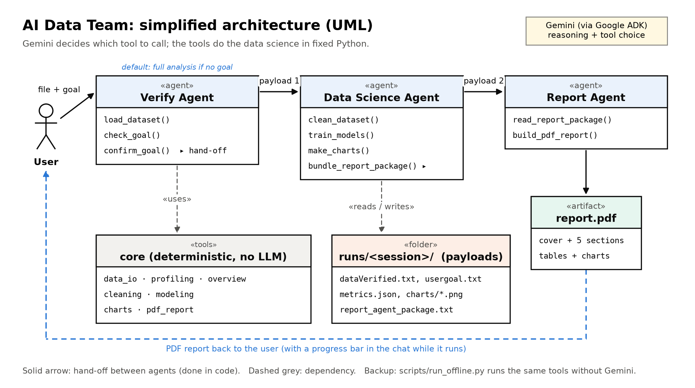

# AI Data Team: Verify → Data Science → Report

Three Google ADK agents, powered by Gemini, that take any tabular dataset and
produce a PDF analysis report:

| Agent | Job | Writes (its "payload") |
|---|---|---|
| **Verify Agent** | Welcomes the user, loads the file, runs a quick EDA, agrees on a goal the data can support | `user_responses.txt`, `dataVerified.txt`, `usergoal.txt`, `dataset.csv` |
| **Data Science Agent** | Cleans the data, trains 3 candidate models, picks the winner, measures feature importance, makes charts | `dataset_changes.txt`, `model_selection_why.txt`, `metrics.json`, `charts/`, `report_agent_package.txt` |
| **Report Agent** | Reads only the package and writes Executive Summary, Methodology, Findings, Limitations, Recommendations | `report.pdf` |

The agents decide *what* to do; the data work is done by **fixed, deterministic
Python tools**, so a live demo behaves the same way every time. Diagrams are in
[docs/architecture.md](docs/architecture.md) (Mermaid; paste into
<https://mermaid.live> to export PNGs for slides).



**Goals that need a new column.** If no single column answers the question, the
Verify Agent calls `create_target` to work one out from existing columns, e.g.
"who passes?" → `passed = G3 >= 10`, "who improved?" → `improvement = G3 - G1`,
"total drinking" → `Dalc + Walc`. Formulas may only use column names, numbers,
`+ - * / ( )`, comparisons and `and`/`or` (no code). The columns the target is
built from are removed from the features so the model can't just recompute the
answer, and the rule is written into `usergoal.txt` and the report.

---

## 1. Setup (about 5 minutes)

Requires **Python 3.14** (3.12 and 3.13 also work).

Windows (PowerShell):

```powershell
cd agent-system
py -3.14 -m venv .venv
.venv\Scripts\Activate.ps1
pip install -r requirements.txt
copy .env.example agents\data_team\.env
# edit agents\data_team\.env and paste your key from https://aistudio.google.com/apikey
```

macOS / Linux:

```bash
cd agent-system
python3.14 -m venv .venv && source .venv/bin/activate
pip install -r requirements.txt
cp .env.example agents/data_team/.env
```

Check everything works without using the API:

```bash
python scripts/run_offline.py --data student --target G3
```

## 2. Run the demo

```bash
adk web agents
```

Open <http://localhost:8000>, pick **data_team** in the top-left, and chat.
Attach files with the paperclip, or ask for a built-in sample.

### Live agent graph (blue highlight on whatever is running)

For the demo, run this instead of `adk web agents`:

```bash
python scripts/web_with_graph.py
```

It starts the same chat UI on <http://localhost:8000> and opens
<http://localhost:8765/?split=1>: the chat on the left and a live graph of the
team on the right (verify_agent → data_science_agent → report_agent, each with
its tools hanging below it). While the team works:

- the agent that is working and the tool it is running get a **glowing blue
  border**, and the arrow between them turns blue and animates;
- the status bar says what is happening, e.g. *data_science_agent is running
  train_models(scenario_name=all_features)*, or *verify_agent is thinking
  (calling Gemini)*, with a timer on the running tool;
- nodes used earlier in the same turn get a green border (red if a tool returned
  an error), and the Activity list on the right logs every step with timings.

Use **Hide chat** to show only the graph (for example full screen on a second
monitor). Plain `adk web agents` shows the graph too, but only after you pick
**data_team** in the chat UI, because that is when ADK loads the agents.
`LIVE_GRAPH_PORT=8766` changes the port and `LIVE_GRAPH=0` turns it off.

**Preview without an API key:** `python scripts/live_graph_demo.py`, then open
<http://localhost:8765>. It runs the real tools on the student data with a
scripted stand-in for Gemini, so you can rehearse the graph without using
credits (add `--pause 2` to slow it down, `--loop` to repeat).

**Suggested demo script (given dataset, ~4 min)**

1. "Hi" → the Verify Agent explains the team and the accepted formats.
2. Attach `sample_data/student-mat.csv` **and** `student-por.csv` (or type
   "use the student sample"). It detects semicolons, stacks both files (1,044 rows) and summarises.
3. Try a bad goal: "Make me a millionaire in 30 days" → it refuses and asks again.
4. "Predict students' final grade G3" → hand-off to the Data Science Agent, which
   runs **with and without G1/G2** automatically, then the Report Agent builds the PDF.
5. Open the **Artifacts** tab in the left panel to download the PDF; show
   `runs/<session>/analysis_1/` to show the payload files passed between agents.

**New-dataset demo (~1 min):** attach `sample_data/winequality-red.csv`
(comma-separated, classification) or `sample_data/penguins.json` (JSON, has
missing values). Both were tested ahead of time. Any `.csv`/`.xlsx`/`.json` works.

**If Gemini or the internet fails on stage:** `python scripts/run_offline.py
--data student --target G3` produces the same files and PDF with templated text.

## 3. Results on the student data (reproducible, seed 42)

| Scenario | Selected model | Test R² | Test MAE (grade points) |
|---|---|---|---|
| All features | Random Forest | 0.83 | 0.93 |
| Without G1, G2 | Random Forest | 0.22 | 2.51 |
| Baseline (always predict the mean) | – | -0.01 | 2.94 |

Talking points: G2 alone explains most of G3 (it is almost the answer). Without
the earlier grades the model is much weaker, and the top drivers become **past
failures, absences, subject (math vs Portuguese), wanting higher education and
school support**, which is what a school could act on early. The cluster of
G3 = 0 students (likely dropouts) is the hardest group to predict.

---

## 4. Code walkthrough

```
agents/data_team/
├── agent.py           the three LlmAgents and how they are chained  (start here)
├── prompts.py         system prompts, adapted from our Lucidchart design
├── tools.py           the functions each agent may call (thin wrappers)
├── session_files.py   saves uploaded files, logs user messages, strips file bytes from LLM calls
├── live_graph.py      callbacks that report what is running + the tiny web server for the graph page
├── live_graph.html    the graph page (plain HTML/SVG/JS, no build step)
├── pipeline.py        each workflow step as a plain function over a run folder
└── core/              deterministic data science, no LLM
    ├── data_io.py     read .csv/.xlsx/.json, detect delimiter, stack same-shaped files
    ├── profiling.py   EDA summary → dataVerified.txt, guess likely targets
    ├── cleaning.py    rule-based cleaning, every change logged in plain English
    ├── modeling.py    task detection, 60/20/20 split, 3 candidates, tie rule, importance, leakage check
    ├── charts.py      matplotlib PNGs
    └── pdf_report.py  reportlab PDF: 5 sections, metrics table, charts
scripts/run_offline.py   whole workflow without Gemini (testing / backup)
scripts/web_with_graph.py   adk web + live agent graph in one command
scripts/live_graph_demo.py  rehearse the live graph with a scripted Gemini (no key needed)
```

**How the hand-offs work (agent.py, tools.py).** `verify_agent` is the root
agent; `data_science_agent` is its sub-agent, and `report_agent` is the DS
agent's sub-agent, exactly the chain in our chart. The hand-off is done in code:
when `confirm_goal` succeeds it sets `tool_context.actions.transfer_to_agent =
"data_science_agent"`, and `bundle_report_package` does the same for
`report_agent`. So the next agent starts only after its payload files exist,
and doesn't depend on the model remembering to transfer. The DS and Report
agents can't transfer back up on their own, so after the report the next user
message returns to the Verify Agent, ready for a new dataset.

**How the live graph works (live_graph.py).** Every agent has the same extra
callbacks: agent start/end, Gemini call start/end, tool start/end. Each one
only appends a small event ("tool_start train_models, called by
data_science_agent") to an in-memory log and returns None, so the agents behave
exactly as before. A small standard-library web server in its own thread serves
the page and streams the events to it (Server-Sent Events); because it has its
own thread, the highlight still updates while a slow tool is busy. The graph's
shape is read from `root_agent` (its `sub_agents` and `tools`), so if we add an
agent or tool it appears automatically. One ADK detail: after a hand-off the
parent agent never reports its own end, so the page treats the first
"agent finished" as the end of the turn.

**Why fixed tools instead of letting the LLM write code.** Generated code can
crash live and gives different answers each run. Here the LLM chooses the
target, which columns to drop, and whether to run a second scenario; the code
that cleans, trains and plots is the same every time.

**Model selection (core/modeling.py).**
- *Task*: category target, or a number with ≤ 10 distinct values → classification; otherwise regression.
- *Split*: 60% train / 20% validation / 20% test, `random_state=42`.
- *Candidates*, simplest first: Ridge / Logistic Regression → Random Forest → Gradient Boosting, each in a pipeline that imputes missing values, scales numbers and one-hot encodes categories.
- *Winner*: best validation R² (regression) or macro-F1 (classification). **Tie rule** (replaces flip-a-coin): scores within 0.01 count as a tie and the simpler model wins.
- *Final score*: the winner is refit on train+validation and scored once on the untouched test set, against a naive baseline.
- *Importance*: permutation importance on the test set (works for any model).
- *Leakage check*: numeric features with |correlation| ≥ 0.8 with the target are flagged; the DS Agent re-runs without them.

**Uploads (session_files.py).** `adk web` sends attached files inside the chat
message. A `before_agent_callback` saves them to `runs/<session>/uploads/` and
logs the user's words (file names only) to `user_responses.txt`. A
`before_model_callback` replaces the file bytes with a short note before each
Gemini call, so large or binary files (like .xlsx) never go to the model.

---

## 5. Deploy to Google Cloud Run (optional)

```bash
gcloud run deploy ai-data-team --source . --region us-central1 \
  --allow-unauthenticated --memory 2Gi \
  --set-env-vars GOOGLE_GENAI_USE_VERTEXAI=FALSE,GOOGLE_API_KEY=YOUR_KEY,GEMINI_MODEL=gemini-3.8-flash,OUTPUT_BUCKET=YOUR_BUCKET
```

The Dockerfile serves the same `adk web` UI on Cloud Run. With `OUTPUT_BUCKET`
set, every finished run folder (payloads, charts, PDF) is copied to
`gs://YOUR_BUCKET/runs/...`; create the bucket first with
`gcloud storage buckets create gs://YOUR_BUCKET --location us-central1`.
For a class project a key in an env var is fine; for anything real, put it in
Secret Manager.

**Switching to Vertex AI** needs no code change: set
`GOOGLE_GENAI_USE_VERTEXAI=TRUE`, `GOOGLE_CLOUD_PROJECT` and
`GOOGLE_CLOUD_LOCATION` instead of `GOOGLE_API_KEY`.

**Changing the model:** set `GEMINI_MODEL` (e.g. a newer Flash or a Pro model).

## 6. Datasets included

| Name to type in chat | File(s) | Notes |
|---|---|---|
| `student` | student-mat.csv + student-por.csv | UCI Student Performance, semicolon-separated, stacked (1,044 rows). Some students appear in both files. |
| `student-math` / `student-portuguese` | one file each | 395 / 649 rows |
| `wine` | winequality-red.csv | UCI Wine Quality (red), 1,599 rows, 240 duplicates removed by cleaning |
| `penguins` | penguins.json | JSON format, missing values; predict `species` |
