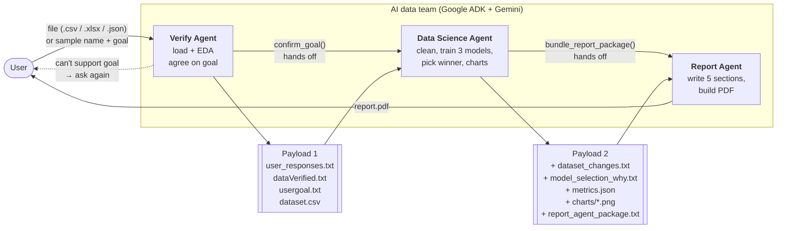
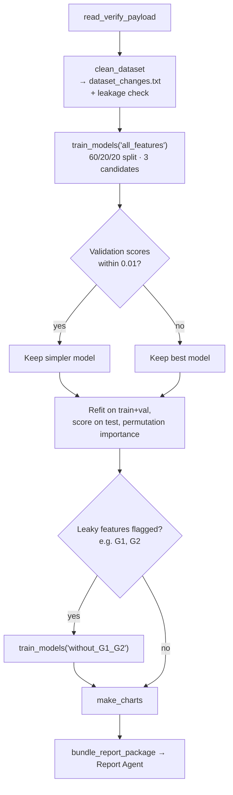
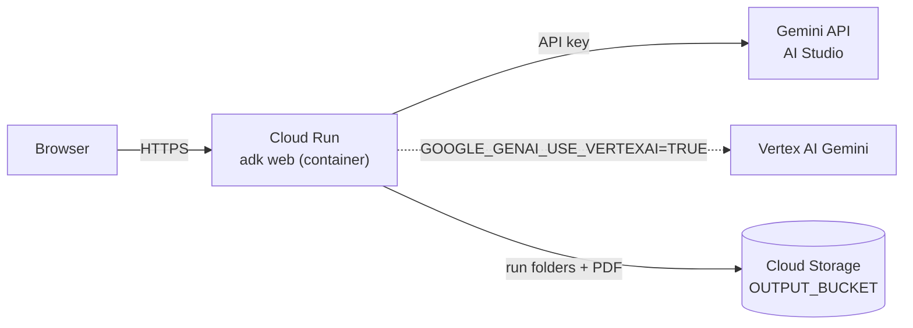

# Architecture

## 1. Agent workflow



## 2. Verify Agent conversation loop

```mermaid
flowchart TD
    S([Start]) --> W[Welcome + explain accepted formats]
    W --> F{File or sample<br/>in message?}
    F -- no --> NF["'I didn't see a dataset…'<br/>(file_not_supported loop)"] --> F
    F -- yes --> L[load_dataset → dataVerified.txt]
    L --> OK{Supported and<br/>≥ 20 rows?}
    OK -- no --> NF
    OK -- yes --> Q["'What do you want to analyze?'<br/>+ 2 examples"]
    Q --> G{Goal given?}
    G -- "'I don't know'" --> DEF[check_goal('') → default target,<br/>'Explain the whole dataset']
    G -- "needs a worked-out column<br/>(pass/fail, change, total)" --> CT["create_target(name, formula)<br/>e.g. passed = G3 >= 10"] --> C
    G -- yes --> C[check_goal(target)]
    C --> SUP{Data supports it?}
    SUP -- no --> NO["'Your dataset doesn't support that'"] --> Q
    SUP -- yes --> CG[confirm_goal → usergoal.txt]
    DEF --> CG
    CG --> DS([Data Science Agent])
```

## 3. Data Science Agent steps (all fixed, tested tools)



## 4. Deployment


